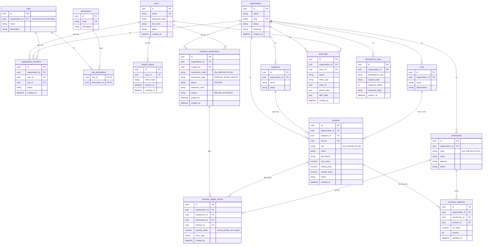

# Stockly – ERD (Release 1)

| Trường | Giá trị |
|---|---|
| Phiên bản | 1.0 |
| Trạng thái | Bản nháp cho Phase 00 |
| Ngày cập nhật | 19/11/2026 |
| Tài liệu liên quan | [Product Brief](01-product-brief.md), [User Stories](02-user-stories.md) |

ERD (Entity Relationship Diagram) mô tả các bảng dữ liệu và quan hệ giữa chúng. Đây là thiết kế ở mức **khái niệm** cho Release 1; schema Prisma thực tế sẽ được viết ở các phase sau và có thể thay đổi chi tiết.

## 1. Quy ước thiết kế

| Quy ước | Nội dung | Lý do |
|---|---|---|
| Khóa chính | UUID | Không đoán được, không lộ số lượng bản ghi |
| Thời gian | `TIMESTAMPTZ`, lưu UTC | Tránh sai lệch múi giờ |
| Số lượng | `NUMERIC(18,3)` | Hỗ trợ đơn vị thập phân (kg, lít) và không sai số làm tròn |
| Tiền | `NUMERIC(18,2)` | Không dùng số thực để tránh lệch tiền |
| Tenant | Mọi bảng nghiệp vụ có `organization_id` | Cách ly dữ liệu giữa các doanh nghiệp |
| Xóa | Dùng cột `status` (ACTIVE, ARCHIVED), không xóa cứng bản ghi đã có lịch sử | Giữ nguyên lịch sử giao dịch |
| Tên bảng, cột | `snake_case` | Quy ước phổ biến của PostgreSQL |

## 2. Sơ đồ ERD



## 3. Vai trò của từng nhóm bảng

| Nhóm | Bảng | Vai trò |
|---|---|---|
| Định danh | `users`, `refresh_tokens` | Tài khoản đăng nhập và phiên làm mới token. `refresh_tokens` chỉ lưu **hash** của token |
| Tổ chức và quyền | `organizations`, `organization_members`, `roles`, `permissions`, `role_permissions` | Một người dùng có thể thuộc nhiều tổ chức với vai trò khác nhau. Vai trò chứa nhiều quyền |
| Danh mục | `categories`, `units`, `products` | Dữ liệu sản phẩm của từng tổ chức |
| Kho | `warehouses` | Nơi lưu hàng |
| Tồn kho | `inventory_balances`, `inventory_transactions`, `inventory_ledger_entries` | Lõi của hệ thống, xem mục 4 |
| Hỗ trợ | `idempotency_keys`, `audit_logs` | Chống ghi trùng giao dịch và lưu vết thao tác |

## 4. Mô hình tồn kho: Transaction, Ledger và Balance

Ba bảng này phối hợp theo cùng một nguyên tắc:

```
Phiếu nhập / xuất / điều chỉnh
        │
        ▼
inventory_transactions   (1 phiếu: ai làm, loại gì, lúc nào)
        │ 1 - nhiều
        ▼
inventory_ledger_entries (từng dòng biến động: sản phẩm, kho, +/- bao nhiêu)
        │ cộng dồn
        ▼
inventory_balances       (tồn hiện tại của mỗi cặp Sản phẩm + Kho)
```

| Bảng | Tính chất | Được sửa không? |
|---|---|---|
| `inventory_transactions` | Phiếu giao dịch | Không, sau khi POSTED |
| `inventory_ledger_entries` | **Lịch sử chính thức**, mỗi dòng là một biến động | **Không bao giờ** sửa hoặc xóa |
| `inventory_balances` | Số liệu tổng hợp để truy vấn nhanh | Chỉ cập nhật bởi hệ thống, trong cùng transaction với ledger |

**Ví dụ:** nhập 100 cái sản phẩm A vào kho 1, sau đó xuất 30.

| Ledger entry | Sản phẩm | Kho | quantity_delta |
|---|---|---|---|
| #1 (RECEIVE) | A | 1 | +100 |
| #2 (ISSUE) | A | 1 | −30 |

`inventory_balances` của (A, kho 1) có `on_hand = 70`. Nếu có lệch giữa balance và tổng ledger thì **ledger là bên đúng**.

**Sửa sai:** nhập nhầm 100 thay vì 10 thì không sửa dòng #1. Tạo giao dịch ADJUST với `quantity_delta = −90` kèm lý do. Lịch sử vẫn đầy đủ và truy vết được.

## 5. Ràng buộc (constraints)

### Unique

| Bảng | Ràng buộc | Lý do |
|---|---|---|
| `users` | `UNIQUE(email)` | Một email, một tài khoản |
| `organizations` | `UNIQUE(slug)` | Định danh dễ đọc, không trùng |
| `organization_members` | `UNIQUE(organization_id, user_id)` | Một người chỉ có một membership trong một tổ chức |
| `products` | `UNIQUE(organization_id, sku)` | **BR-001**: SKU duy nhất trong tổ chức, khác tổ chức thì được trùng |
| `warehouses` | `UNIQUE(organization_id, code)` | Mã kho duy nhất trong tổ chức |
| `categories`, `units` | `UNIQUE(organization_id, name)` | Không trùng tên trong tổ chức |
| `inventory_balances` | `UNIQUE(organization_id, warehouse_id, product_id)` | **BR-013**: mỗi cặp Sản phẩm + Kho chỉ có một dòng tồn |
| `inventory_transactions` | `UNIQUE(organization_id, transaction_code)` | Mã phiếu không trùng |
| `idempotency_keys` | `UNIQUE(organization_id, idempotency_key)` | **BR-012**: chặn giao dịch trùng |

### Check

| Bảng | Ràng buộc | Lý do |
|---|---|---|
| `inventory_balances` | `on_hand >= 0` | **BR-006**: tồn không âm, là lớp bảo vệ cuối ngay tại database |
| `inventory_ledger_entries` | `quantity_delta <> 0` | Biến động bằng 0 là vô nghĩa |
| `products` | `cost_price >= 0` và `selling_price >= 0` | **BR-005** |

### Khóa ngoại và cách ly tenant

Mọi quan hệ giữa các bảng nghiệp vụ phải cùng tổ chức (**BR-030**). Ví dụ `inventory_balances` không được trỏ tới một sản phẩm của tổ chức khác. Phương án dự kiến là **khóa ngoại kép**: thêm `UNIQUE(organization_id, id)` vào bảng cha rồi tham chiếu cả `(organization_id, product_id)`.

*Lưu ý:* Prisma xử lý khóa ngoại kép có một số hạn chế. Quyết định cuối cùng (khóa ngoại kép, kiểm tra ở tầng service hoặc PostgreSQL Row-Level Security) sẽ được ghi thành ADR khi làm Phase 02–03.

### Index đề xuất

| Bảng | Index | Phục vụ |
|---|---|---|
| Mọi bảng nghiệp vụ | `organization_id` | Mọi truy vấn đều lọc theo tổ chức |
| `products` | `(organization_id, name)` | Tìm kiếm, sắp xếp |
| `inventory_ledger_entries` | `(organization_id, product_id, warehouse_id, created_at)` | Xem lịch sử và đối chiếu |
| `inventory_transactions` | `(organization_id, created_at)` | Danh sách giao dịch theo thời gian |
| `audit_logs` | `(organization_id, created_at)` | Xem nhật ký |

## 6. Quyết định thiết kế và lý do

| Quyết định | Lý do |
|---|---|
| Dùng **schema chung** có `organization_id` thay vì mỗi tổ chức một database | Đơn giản vận hành, đủ tốt cho quy mô dự án; chi tiết sẽ viết trong ADR-002 |
| `roles.organization_id` cho phép **NULL** | Vai trò hệ thống (Owner, Admin, Warehouse Manager, Warehouse Staff) dùng chung cho mọi tổ chức; vai trò tùy chỉnh sau này gắn với tổ chức |
| Tách **Ledger** khỏi **Balance** | Ledger giữ lịch sử không đổi để truy vết; Balance giúp đọc tồn nhanh mà không phải cộng dồn hàng nghìn dòng mỗi lần |
| `inventory_balances.version` | Hỗ trợ phát hiện xung đột khi nhiều người cập nhật cùng lúc |
| Không xóa cứng sản phẩm và kho | **BR-003**: lịch sử giao dịch phải còn nguyên ý nghĩa |
| `inventory_transactions.reason` | Điều chỉnh tồn bắt buộc có lý do (US-INV-03) |
| `organizations.timezone` | Lưu UTC nhưng hiển thị theo múi giờ tổ chức (US-INV-06) |

## 7. Khác biệt so với blueprint

| Nội dung | Blueprint | Release 1 | Lý do |
|---|---|---|---|
| `inventory_balances.reserved` | Có | **Chưa có** | Giữ hàng (reservation) đã hoãn lại; chỉ cần On Hand. Thêm bằng migration sau |
| `products.barcode` | Có | Chưa có | Barcode để Release 2 |
| `categories.parent_id` | Có (danh mục cha con) | Chưa có | Danh mục phẳng là đủ cho Release 1 |
| `inventory_transactions.reference_type`, `reference_id` | Có | Thay bằng `reference_note` | Dùng để liên kết PO, chuyển kho ở Release 2 |
| `inventory_transactions.reason`, `organizations.timezone` | Chưa có rõ | **Thêm mới** | Phục vụ US-INV-03 và US-INV-06 |
| `warehouse_locations` | Có | Chưa có | Vị trí trong kho để Release 2 |
| `notifications`, `outbox_events` | Có | Chưa có | Hoãn lại theo Product Brief |

## 8. Bảng dành cho Release 2

`suppliers`, `purchase_orders`, `purchase_order_items`, `goods_receipts`, `goods_receipt_items`, `stock_transfers`, `stock_transfer_items`, `warehouse_locations`, `notifications`.

## 9. Kiểm tra đối chiếu (reconciliation)

Số liệu Balance phải luôn khớp tổng Ledger. Truy vấn sau tìm các cặp bị lệch (kết quả đúng là **không có dòng nào**):

```sql
SELECT b.organization_id, b.warehouse_id, b.product_id,
       b.on_hand, COALESCE(l.total, 0) AS ledger_total
FROM inventory_balances b
LEFT JOIN (
  SELECT organization_id, warehouse_id, product_id,
         SUM(quantity_delta) AS total
  FROM inventory_ledger_entries
  GROUP BY organization_id, warehouse_id, product_id
) l USING (organization_id, warehouse_id, product_id)
WHERE b.on_hand <> COALESCE(l.total, 0);
```

Truy vấn này sẽ trở thành một test tự động ở Phase 04 và 07.